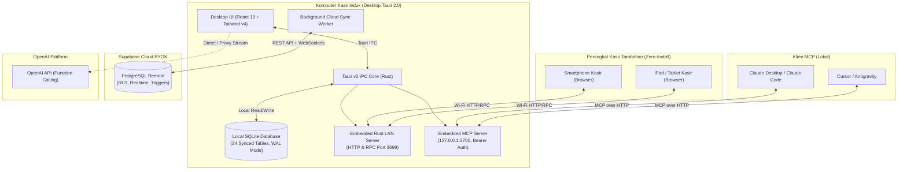

# 🚀 Kivo — Modern Multi-Branch POS & ERP Platform (v1.6.0)

<div align="center">


**Next-Generation Offline-First Point of Sale & Enterprise Resource Planning**  
*Engineered with Rust, Tauri 2.0, React 19, SQLite, and Supabase Cloud Sync.*

[](https://github.com/AchiraStudio/kivo/releases)
[](https://www.rust-lang.org/)
[](https://tauri.app/)
[](https://react.dev/)
[](https://www.typescriptlang.org/)
[](https://tailwindcss.com/)
[](https://www.sqlite.org/)
[](https://supabase.com/)
[](https://modelcontextprotocol.io/)
[](LICENSE)

[Fitur Utama](#-fitur-utama-ekosistem-kivo) •
[Apa yang Baru](#-apa-yang-baru-di-versi-154) •
[MCP Server](#-kivo-mcp-server-hubungkan-claude--cursor) •
[Arsitektur Sistem](#-arsitektur-sistem) •
[Instalasi & Menjalankan](#-instalasi--menjalankan) •
[Konfigurasi BYOK](#-arsitektur-keamanan-byok-bring-your-own-key) •
[Hardware & POS](#-dukungan-hardware--printer-pos) •
[Struktur Kode](#-struktur-folder-proyek)

</div>

---

## 📖 Tentang Kivo

**Kivo** adalah platform manajemen bisnis, Point of Sale (POS), dan Enterprise Resource Planning (ERP) modern dengan arsitektur **Offline-First**, dirancang khusus untuk bisnis ritel, apotek, klinik, grosir, minimarket, dan F&B multi-cabang.

Berbeda dengan sistem POS konvensional yang bergantung penuh pada koneksi internet, Kivo memproses seluruh transaksi langsung di atas **database SQLite lokal berkecepatan tinggi** dengan engine backend native **Rust (Tauri 2.0)**. Transaksi kasir, pencarian ribuan SKU obat/barang, dan pencetakan struk thermal berjalan seketika.

Ketika internet aktif, sistem secara otomatis melakukan sinkronisasi dua arah (*bidirectional sync*) ke **Supabase Cloud** untuk mengonsolidasikan laporan penjualan, pergerakan stok antar-cabang, dan jurnal akuntansi secara terpusat.

Kivo dibangun dengan prinsip privasi mutlak: **100% Bring Your Own Key (BYOK)**. Tidak ada API key, database pihak ketiga, ataupun kredensial tersembunyi yang ditanam di dalam aplikasi.

Anda juga **tidak perlu menginstal aplikasi di setiap kasir**: nyalakan **Host QR Terminal**, lalu staf dapat membuka kasir dari smartphone (iPhone/Android) atau tablet/iPad melalui Wi-Fi lokal.

---

## ✨ Apa yang Baru di Versi 1.6.0?

```
┌────────────────────────────────────────────────────────────────────────┐
│                         HIGHLIGHT RILIS KIVO v1.6.0                    │
├────────────────────────────────────────────────────────────────────────┤
│ 📱 Aplikasi Android        · APK resmi di setiap rilis GitHub          │
│ 🔄 Update Otomatis         · Unduh & pasang versi baru dari dalam app  │
│ 🧭 UI HP Dirombak          · Bilah bawah, tombol Kasir, bottom sheet   │
│ 👤 Input Pelanggan Cepat   · Form HP, tier 1 ketukan, Simpan + Baru    │
└────────────────────────────────────────────────────────────────────────┘
```

* **Aplikasi Android:** Terhubung ke komputer kasir lewat Wi-Fi (pindai Host QR atau ketik IP) atau dipakai mandiri. Kamera HP untuk scan barcode, termasuk di WebView Android yang tidak punya detektor bawaan. Lihat [Aplikasi Android](#-aplikasi-android).
* **Update Otomatis Android:** Aplikasi memeriksa rilis GitHub, mengunduh APK, memeriksa checksum dan kunci tanda tangan, lalu membukanya di pemasang Android.
* **UI HP Dirombak:** Top bar dengan status koneksi, bilah bawah dengan tombol Kasir di tengah dan lencana keranjang, menu *bottom sheet*, daftar produk berbentuk kartu, area sentuh lebih besar di kasir, dan tombol Kembali Android yang menutup panel sebelum keluar.
* **Input Pelanggan Cepat:** Form pelanggan di HP, filter tier, telepon/WhatsApp, **Perpanjang** member satu ketukan, dan tambah pelanggan langsung dari kasir.
* **Rilis Windows + Android Sekaligus:** Satu tag versi membangun installer Windows dan APK, lalu menerbitkannya dalam satu rilis.

Catatan rilis lengkap: [`RELEASE_NOTES_v1.6.0.md`](RELEASE_NOTES_v1.6.0.md).

### Sorotan v1.5.5

* **Scanner 2D (QR / DataMatrix GS1)**, **Registrasi Cepat** barcode, scan langsung ke keranjang, dan pembacaan scan yang lebih andal. Lihat [`RELEASE_NOTES_v1.5.5.md`](RELEASE_NOTES_v1.5.5.md).

### Sorotan v1.5.4

```
┌────────────────────────────────────────────────────────────────────────┐
│                         HIGHLIGHT RILIS KIVO v1.5.4                    │
├────────────────────────────────────────────────────────────────────────┤
│ 🔌 MCP Server Bawaan   · Hubungkan Claude/Cursor ke data Kivo (40 tool)│
│ 📷 Scan Kamera         · Scan barcode via kamera HP/tablet di semua    │
│                          alur stok, penerimaan, dan kasir              │
│ 🔫 Scanner Hardware    · Hook baru: bunyi beep, anti salah-scan        │
│ 🤖 Kivo AI Lebih Pintar· 45 tool, input barang massal dalam 1 langkah  │
└────────────────────────────────────────────────────────────────────────┘
```

* **MCP Server Bawaan:** Server MCP (*Streamable HTTP*) berjalan otomatis bersama aplikasi desktop di `http://127.0.0.1:3700/mcp`, diamankan dengan Bearer token. Lihat [panduan MCP](#-kivo-mcp-server-hubungkan-claude--cursor).
* **Scan Barcode via Kamera:** Tombol scan ditambahkan di **POS**, **Daftar Produk**, **Form Produk**, **Tambah Stok Massal**, **Stock Opname**, dan **Penerimaan Langsung**. Tersedia input manual sebagai cadangan bila kamera tidak tersedia.
* **Hook Scanner Hardware Baru:** Opsi `enabled`, `minLength`, `maxKeyIntervalMs`, `allowInInputs`, dan `playBeep`; scan diakhiri `Enter` atau `Tab`, mengabaikan kombinasi Ctrl/Alt/Meta, dan memberi nada beep saat berhasil/gagal.
* **Kivo AI Diperkuat:** Toolset AI naik menjadi 45 tool (termasuk `bulk_add_items`, `bulk_stock_opname`, edit harga eceran/grosir/HPP, buat & hapus promo). AI memakai default cerdas dan tidak lagi menanyakan field opsional berulang kali.

Catatan rilis lengkap: [`RELEASE_NOTES_v1.5.4.md`](RELEASE_NOTES_v1.5.4.md) · versi sebelumnya: [v1.5.3](RELEASE_NOTES_v1.5.3.md), [v1.5.2](RELEASE_NOTES_v1.5.2.md), [v1.4.0](RELEASE_NOTES_v1.4.0.md), [v1.3.2](RELEASE_NOTES_v1.3.2.md).

### Sorotan Rilis Sebelumnya (v1.4.0 – v1.5.3)

* **Terminal Kasir Web Zero-Install (LAN Host Engine):** Komputer kasir utama menjadi server lokal (server HTTP/RPC tersemat di Rust, port default `3699`). Klik **Host QR** di topbar, pindai dengan kamera HP/tablet, dan kasir langsung terbuka di browser dengan sesi workspace induk.
* **UI/UX Mobile & Tablet "Space-Efficient":** Bottom navigation, sidebar desktop otomatis sembunyi di `< 768px`, tab Katalog/Keranjang 50/50, dan *Floating Cart Capsule* dengan total real-time.
* **Kartu Produk Standout:** Avatar bertema kategori, indikator stok berwarna (`● 24`, `● Sisa 2`, `● Habis`), dan highlight otomatis untuk item di keranjang.
* **Design System "Calm Utility" (v1.5.2):** Satu sistem desain untuk seluruh halaman, modal, drawer, dan dropdown ([`DESIGN.md`](DESIGN.md)).
* **Topbar Terpadu & Perbaikan Mobile (v1.5.3):** Topbar desktop 44px tunggal, bottom navigation yang tidak lagi menutupi tombol checkout, dan perbaikan loop reload sinkronisasi LAN di POS.
* **Pembersihan Workspace Hantu:** Supabase Cloud menjadi penentu mutlak ketersediaan workspace saat online.
* **Build Android:** Skrip `npm run android:apk` tersedia untuk membuat APK (lihat [Instalasi](#-instalasi--menjalankan)).

---

## ⚡ Fitur Utama Ekosistem Kivo

```
┌────────────────────────────────────────────────────────────────────────┐
│                              EKOSISTEM KIVO                            │
├──────────────┬──────────────┬──────────────┬─────────────┬─────────────┤
│   Kivo POS   │Kivo Inventory│  Purchasing  │ Accounting  │   Kivo AI   │
│  Kasir Kilat │Multi-Satuan  │ Order & HPP  │ Buku Besar  │ Asisten &   │
│ Split Bayar  │Batch & Exp   │ Penerimaan   │ Laba Rugi   │ MCP Server  │
│ Cetak Struk  │Stock Opname  │ Hutang (AP)  │ Neraca      │             │
├──────────────┴──────────────┴──────────────┴─────────────┴─────────────┤
│                          Kivo Cloud & LAN                              │
│       Sinkronisasi 34 Tabel Supabase  ·  Peer-to-Peer Tanpa Internet   │
└────────────────────────────────────────────────────────────────────────┘
```

### 1. 🛒 Kivo POS (Point of Sale & Kasir Kilat)
* **Pencarian Kilat & Scanner Barcode:** Pencarian instan ribuan SKU, scanner hardware (USB/Bluetooth) dan **scan via kamera**, serta navigasi kategori sekali klik.
* **Manajemen Sesi Kasir (Cash Shifts):** Kas modal awal saat buka shift, pencatatan kas masuk/keluar, dan rekonsiliasi kas laci saat tutup shift.
* **Split Payment & Multi-Payment:** Tunai, QRIS, Transfer Bank, Kartu Debit/Kredit, dan Piutang Pelanggan (*Credit Limit*) dalam satu transaksi.
* **Mesin Promosi Otomatis:**
  - BOGO (*Buy One Get One*)
  - Diskon Persentase & Potongan Nominal
  - Harga Grosir Bertingkat (*Tiered Quantity Pricing*)
  - Promo Bundling Paket
  - Diskon Khusus Member & VIP
* **Retur Penjualan (Sales Return):** Retur penuh atau sebagian per faktur dengan pengembalian stok otomatis ke kartu stok.
* **Loyalitas Pelanggan:** Poin belanja, batas piutang (*credit limit*), dan masa berlaku kartu member.
* **Kustomisasi Total & Negosiasi Harga:** Ubah total bayar manual untuk transaksi tawar-menawar grosir dengan pencatatan selisih otomatis.

### 2. 📦 Kivo Inventory & Katalog Produk
* **Hierarki Multi-Satuan:** Konversi satuan bertingkat (contoh: *Karton ➔ Box ➔ Strip ➔ Tablet*) dengan pengali dan harga jual independen per satuan.
* **Manajemen Batch & Tanggal Kadaluarsa:** Pelacakan nomor batch, pengingat kadaluarsa dini (*early expiry alert*), dan badge obat resep dokter (**`Rx`**).
* **Stock Opname Digital:** Hitung fisik berkala dengan rekap selisih (*variance*) dan jurnal penyesuaian otomatis. Scan barcode untuk menambah hitungan satu per satu.
* **Tambah Stok Massal & Penerimaan Langsung:** Input stok cepat dengan scanner hardware maupun kamera.
* **Kartu Stok Mendalam (Stock Ledger):** Rekam jejak seluruh mutasi: Penjualan, Pembelian, Retur, dan Penyesuaian Manual.

### 3. 📥 Kivo Purchasing & Pengadaan Barang
* **Surat Pesanan / Purchase Order (PO):** PO resmi ke supplier dengan estimasi biaya dan tanggal perkiraan kirim.
* **Penerimaan Barang (Goods Receipt):** Verifikasi barang datang terhadap PO atau penerimaan langsung (*Direct Receive*).
* **Perhitungan HPP / COGS Otomatis:** HPP diperbarui setiap kali ada barang masuk gudang.
* **Manajemen Hutang Usaha (Accounts Payable):** Jatuh tempo faktur supplier dan riwayat cicilan hutang.

### 4. 📑 Kivo Double-Entry Accounting (Akuntansi Terintegrasi)
* **Jurnal Otomatis:** Setiap transaksi kasir, pembelian, retur, dan mutasi kas membentuk jurnal debit/kredit tanpa input akuntan manual.
* **Bagan Akun (COA):** Hierarki standar (Aset Lancar, Kas & Bank, Piutang, Persediaan, Kewajiban, Ekuitas, Pendapatan, HPP, Beban Operasional).
* **Laporan Keuangan Standar:**
  - Laporan Laba Rugi (*Profit & Loss Statement*)
  - Laporan Neraca (*Balance Sheet*)
  - Neraca Saldo (*Trial Balance*)
* **Valuasi Persediaan:** Pilihan **Average (Rata-rata)**, **FIFO**, atau **LIFO**.

### 5. 🤖 Kivo AI Assistant (BYOK)
* **Asisten Bisnis Interaktif:** Akses cepat dari tombol di Topbar atau shortcut keyboard.
* **Function Calling Cerdas (45 tool):** Membaca dan mengubah data SQLite lokal untuk menjawab dan mengerjakan permintaan Anda:
  - *"Berapa omset toko hari ini dan metode bayar apa yang paling dominan?"*
  - *"Sebutkan 5 produk dengan stok menipis yang harus segera di-order!"*
  - *"Tambahkan 20 barang ini sekaligus: ..."* (input massal dalam 1 langkah)
  - *"Cek apakah ada obat/barang yang kadaluarsa bulan depan."*
* **Batasan Aman:** AI menolak aksi admin destruktif (reset database, hapus user, ubah hak akses, ubah konfigurasi cloud/API key).
* **Model Fleksibel:** Kompatibel dengan model OpenAI (`gpt-4o-mini`, `gpt-4o`, `o3-mini`, dll.) menggunakan API Key Anda sendiri.

### 6. ☁️ Kivo Cloud & Multi-Branch Sync
* **Sinkronisasi 34 Tabel Supabase:** Data master, transaksi, promo, dan jurnal tersinkronisasi antar cabang.
* **Pencegahan Sync-Loop:** Flag `updated_by` mencegah loop data bolak-balik antara kasir dan cloud.
* **Multi-Tenant Workspace:** Buat workspace baru atau hubungkan cabang lain dengan **Kode Undangan**.
* **Fitur Nuke Data Cloud:** Kosongkan transaksi & katalog uji coba di cloud dengan jaminan akun user dan workspace tetap aman.

### 7. 🌐 Kivo LAN Sync (Jaringan Lokal Tanpa Internet)
* **Peer-to-Peer Kasir Lokal:** Kasir di toko yang sama saling terhubung melalui Wi-Fi / LAN tanpa internet.
* **UDP Auto-Discovery:** Menemukan terminal server Kivo lain di jaringan lokal secara otomatis.

---

## 🔌 Kivo MCP Server (Hubungkan Claude / Cursor)

Sejak v1.5.4, Kivo menyertakan server **Model Context Protocol (MCP)** bawaan sehingga klien AI eksternal dapat membaca dan mengelola data Kivo Anda.

| | |
| :--- | :--- |
| **Endpoint** | `http://127.0.0.1:3700/mcp` (Streamable HTTP, protokol `2025-03-26`) |
| **Health check** | `http://127.0.0.1:3700/mcp/health` |
| **Autentikasi** | `Authorization: Bearer kivo_mcp_...` |
| **Jangkauan** | Hanya `127.0.0.1` (tidak dapat diakses dari perangkat lain) |
| **Platform** | Aplikasi desktop (tidak aktif di Android/iOS) |
| **Jumlah tool** | 40 tool, dengan anotasi *read-only* / *destructive* |

### Cara Menghubungkan
1. Jalankan Kivo desktop (`npm run tauri dev` atau aplikasi terinstal). Server aktif otomatis.
2. Buka **Pengaturan ➔ MCP Server**, lalu salin **Bearer token**.
3. Tambahkan ke klien MCP Anda. Contoh **Claude Code**:
   ```bash
   claude mcp add --transport http kivo http://127.0.0.1:3700/mcp \
     --header "Authorization: Bearer <token-anda>"
   ```
   Untuk Claude Desktop, Cursor, atau Antigravity, gunakan tombol **salin konfigurasi** di halaman pengaturan (JSON `mcpServers` siap tempel).
4. Gunakan tombol **Regenerate** bila token bocor. Seluruh klien harus diperbarui dengan token baru.

### Tool yang Tersedia
| Kategori | Tool |
| :--- | :--- |
| **Inventaris** | `search_items`, `get_item_detail`, `add_item`, `bulk_add_items`, `update_item`, `delete_item` |
| **Stok** | `get_stock_overview`, `get_low_stock_alerts`, `get_expiring_items`, `get_stock_valuation`, `adjust_stock`, `bulk_stock_opname` |
| **Katalog** | `get_categories`, `add_category`, `get_brands`, `add_brand` |
| **Pembelian** | `get_suppliers`, `add_supplier`, `get_purchase_orders`, `receive_goods_direct` |
| **Pelanggan & Klinik** | `get_customers`, `add_customer`, `get_health_records`, `save_health_record` |
| **Penjualan & Promo** | `get_sales`, `get_sales_summary`, `get_top_selling_items`, `get_sales_by_payment_method`, `get_promos`, `toggle_promo_active` |
| **Akuntansi** | `get_accounts`, `create_account`, `record_cash_in`, `record_cash_out`, `get_profit_loss`, `get_balance_sheet` |
| **Admin (terbatas)** | `get_users`, `add_user`, `get_workspaces`, `create_workspace` |

> ⚠️ Tool bertanda tulis mengubah **data produksi** secara langsung. Kontrol admin destruktif (reset database, ubah hak akses, hapus user, konfigurasi cloud/API key) sengaja **tidak** diekspos. Perlakukan token seperti password.

---

## 🏛️ Arsitektur Sistem

Kivo menggabungkan keandalan sistem native desktop dengan fleksibilitas antarmuka web modern:



---

## 🛡️ Arsitektur Keamanan BYOK (Bring Your Own Key)

Kivo menerapkan model keamanan zero-trust:

1. **Tanpa Kredensial Bawaan:** Tidak ada token API, URL Supabase, atau fallback secret di dalam kode sumber maupun file binary rilis.
2. **Tanpa Compile-Time Leaks:** Makro `option_env!` telah dihapus seluruhnya dari backend Rust, mencegah kebocoran env mesin developer ke aplikasi pengguna.
3. **Penyimpanan Terisolasi:** Kredensial Supabase dan OpenAI disimpan di SQLite lokal (`global_settings`) dan `localStorage` pengguna.
4. **Pembersihan Cloud Aman (Safe Cloud Nuke):** Dirancang hierarkis (child-to-parent) dan **mengecualikan secara mutlak** tabel `users`, `user_roles`, `workspaces`, dan `workspace_members`.
5. **MCP Hanya Lokal & Berautentikasi:** Server MCP hanya mendengarkan di `127.0.0.1`, mewajibkan Bearer token, dan tidak mengekspos kontrol admin destruktif.

---

## 💻 Instalasi & Menjalankan

### Persyaratan Sistem
* **Sistem Operasi:** Windows 10/11 (64-bit), macOS 11+, atau Linux
* **Node.js:** v18.0.0 atau lebih baru (direkomendasikan v20+)
* **Rust:** v1.75.0 atau lebih baru (`rustup toolchain install stable`)
* **Build Tools Windows:** C++ Build Tools (via Visual Studio Installer)
* **Android (opsional):** Android Studio + SDK/NDK untuk build APK

### Langkah Menjalankan Aplikasi

1. **Clone Repositori:**
   ```bash
   git clone https://github.com/AchiraStudio/kivo.git
   cd kivo
   ```

2. **Instal Dependensi Frontend:**
   ```bash
   npm install
   ```

3. **Jalankan Aplikasi Desktop (Development Mode):**
   ```bash
   npm run tauri dev
   ```
   *Server MCP otomatis aktif di `http://127.0.0.1:3700/mcp`.*

4. **Jalankan Situs Showcase (demo langsung):**
   ```bash
   npm run demo:dev      # http://localhost:1430
   npm run demo:build    # hasil di demo/dist
   ```
   Situs ini menjalankan **UI Kivo yang asli** (dari `src/`) di browser dengan host tiruan di memori, jadi selalu mengikuti tampilan terbaru. Situs bisa dihosting di Cloudflare Pages/Netlify/Vercel (root `demo`, build `npm run build`, output `dist`) atau di GitHub Pages (opsional: Source *GitHub Actions* + variabel repo `DEMO_GITHUB_PAGES=true`); tombol unduh selalu membaca rilis terbaru dari GitHub. Detail di [`demo/README.md`](demo/README.md).

5. **Build Installer Windows (.exe / .msi):**
   ```bash
   npm run tauri build
   ```
   *Installer tersedia di `src-tauri/target/release/bundle/`.*

6. **Build APK Android (opsional):**
   ```bash
   npm run android:init       # sekali saja (proyek gen/android sudah ada di repo)
   npm run android:apk        # debug APK
   npm run android:apk:release
   npm run android:apk:universal
   ```
   Di Linux/macOS (atau CI) cukup: `npm run tauri -- android build --apk`.

### 📱 Aplikasi Android

Aplikasi Android punya dua cara pakai, dipilih saat pertama dibuka:

* **Terhubung ke komputer kasir (disarankan):** HP menjadi terminal untuk Kivo desktop lewat Wi-Fi yang sama. Pindai **Host QR** di topbar Kivo desktop (atau ketik alamat IP-nya) dan HP langsung masuk dengan akun kasir. Stok, penjualan, dan laporan selalu sama dengan komputer.
* **Mandiri:** HP menyimpan database sendiri (SQLite lokal), lengkap dengan Setup Wizard dan sinkronisasi cloud.

Antarmuka HP memakai bilah bawah dengan tombol **Kasir** di tengah, penanda koneksi ke komputer kasir, menu bergaya *bottom sheet*, dan tombol Kembali Android yang menutup panel sebelum keluar aplikasi. Pemindaian barcode memakai kamera HP (izin kamera diminta saat pertama dipakai).

* **Pembaruan otomatis:** aplikasi memeriksa rilis GitHub saat dibuka dan saat kembali ke latar depan. Bila ada versi baru, muncul panel *Pembaruan tersedia*; ketuk **Perbarui** dan APK diunduh, diperiksa (checksum dan kunci tanda tangan), lalu dibuka di pemasang Android. Android meminta izin *Pasang aplikasi tidak dikenal* untuk Kivo satu kali saja. Agar pembaruan bisa menimpa versi lama, setiap rilis harus ditandatangani dengan kunci yang sama (lihat di bawah).
* **Input pelanggan cepat:** tombol **+ Pelanggan** membuka formulir bergaya *bottom sheet* dengan keypad nomor HP, pilihan tier satu ketukan, masa berlaku member (+1/3/6/12 bulan), dan **Simpan + Baru** untuk memasukkan banyak pelanggan berturut-turut. Daftar pelanggan menampilkan filter tier, penanda member yang akan habis, tombol telepon/WhatsApp, dan **Perpanjang** satu ketukan. Di kasir, **Pelanggan baru** langsung memilih pelanggan yang baru dibuat untuk transaksi berjalan.

### 🚢 Rilis (Windows + Android sekaligus)

Mendorong tag versi membangun installer Windows **dan** APK Android, lalu menerbitkannya dalam satu GitHub Release:

```bash
# naikkan versi di package.json, src-tauri/tauri.conf.json, dan src-tauri/Cargo.toml, lalu:
git tag v1.5.6 && git push origin v1.5.6
```

Workflow `release.yml` baru menerbitkan rilis bila `.exe`/`.msi` **dan** `.apk` sudah terlampir. Menjalankan workflow lewat **Run workflow** hanya membangun dan menyimpan hasilnya sebagai artifact tanpa menerbitkan apa pun.

**Penandatanganan APK.** Agar APK versi baru bisa menimpa versi lama di HP, tanda tangani dengan kunci yang sama setiap rilis. Buat kunci sekali saja, simpan baik-baik, dan jangan commit ke repositori:

```bash
keytool -genkeypair -v -keystore kivo-release.jks -alias kivo \
  -keyalg RSA -keysize 2048 -validity 10000
base64 -w0 kivo-release.jks   # salin hasilnya ke secret ANDROID_KEYSTORE_BASE64
```

Tambahkan empat secret di *Settings → Secrets and variables → Actions*: `ANDROID_KEYSTORE_BASE64`, `ANDROID_KEYSTORE_PASSWORD`, `ANDROID_KEY_ALIAS`, `ANDROID_KEY_PASSWORD`. Tanpa secret ini APK tetap terbangun, tetapi ditandatangani dengan kunci debug sementara (workflow menampilkan peringatan) dan tidak bisa menimpa APK yang ditandatangani dengan kunci lain. Untuk build lokal, taruh `storeFile` (path absolut), `storePassword`, `keyAlias`, `keyPassword` di `src-tauri/gen/android/keystore.properties` (sudah di-gitignore).

---

## 🚀 Panduan Pengaturan Pertama Kali (Setup Wizard)

Saat pertama kali membuka aplikasi di komputer baru, Kivo menampilkan **Onboarding Setup Wizard**:

1. **Pilih Mode:**
   * **Buat Toko Baru:** Mulai database toko baru dari nol (offline).
   * **Gabung Workspace:** Masukkan kode undangan dari cabang utama untuk sinkronisasi katalog.
2. **Profil Toko:** Nama toko, nama cabang, nomor telepon, alamat, dan logo struk.
3. **Integrasi Supabase Cloud (BYOK - Opsional):**
   * Buat project gratis di [supabase.com](https://supabase.com).
   * Buka **SQL Editor** di Supabase, lalu jalankan [`supabase_full_bootstrap.sql`](supabase_full_bootstrap.sql).
   * Salin **Project URL** dan **Anon Key** ke setup wizard.
4. **Kivo AI Assistant (BYOK - Opsional):**
   * Masukkan API Key OpenAI Anda (`sk-...`) dari [platform.openai.com/api-keys](https://platform.openai.com/api-keys).
5. **Buat Akun Pemilik (Master Owner):** Tentukan username dan password untuk akun administrator tertinggi.
6. **Selesai:** Anda langsung diarahkan ke Dashboard utama.

---

## 🖨️ Dukungan Hardware & Printer POS

Kivo mendukung printer thermal POS melalui protokol **ESC/POS** standar dan driver **HPRT Windows SDK**:

* **Koneksi:** USB, Network (LAN / Ethernet TCP/IP), dan Bluetooth.
* **Ukuran Kertas:** 58mm dan 80mm.
* **Fitur Struk:**
  - Cetak logo toko monokrom di header struk.
  - Cetak otomatis saat pembayaran sukses (*Auto-Print*).
  - Pembuka laci uang otomatis (*Auto Cash Drawer Kick* via pin RJ11).
  - Pemotong kertas otomatis (*Auto Paper Cut*).
* **Scanner Barcode:** Scanner USB/Bluetooth (mode keyboard wedge) dan kamera perangkat.
* **Konfigurasi:** **Pengaturan** ➔ tab **Printer & Hardware POS**.

---

## ⌨️ Shortcut Keyboard Kasir (POS Desktop)

| Tombol | Fungsi |
| :--- | :--- |
| `F1` | Buka Pencarian Cepat Produk / Barcode |
| `F2` | Buka Laci Kasir (Cash Drawer Kick) |
| `F3` | Pilih Pelanggan / Cek Poin Member |
| `F4` | Tahan Transaksi Sementara (Hold Bill) |
| `F7` | Lihat Riwayat & Cetak Ulang Nota |
| `F8` / `Alt+T` | Kustomisasi / Tawar Total Harga Manual |
| `Alt+H` | Edit Harga Baris Barang yang Dipilih |
| `Alt+S` | Edit Subtotal Baris Barang yang Dipilih |
| `End` / `Space` | Langsung ke Layar Pembayaran & Checkout |
| `Esc` | Tutup Modal / Dialog yang Aktif |

---

## 🗂️ Struktur Folder Proyek

```
kivo/
├── src/                          # Frontend (React 19 + Vite + Tailwind v4)
│   ├── components/
│   │   ├── ai/                   # Modal & Widget Kivo AI Chat
│   │   ├── common/               # HostQrModal, KivoLogo, ConfirmModal
│   │   ├── layout/               # Sidebar, Topbar, MobileNav, MobileMenuDrawer
│   │   └── ui/                   # Modal, Drawer, TabBar, Select, Toast, BarcodeCameraModal
│   ├── pages/
│   │   ├── accounting/           # Akuntansi, Jurnal, Laba Rugi, Neraca
│   │   ├── inventory/            # Stok, Katalog, Multi-Satuan, Opname
│   │   ├── onboarding/           # Setup Wizard pertama kali
│   │   ├── pos/                  # Kasir POS, Pembayaran, Struk, Retur
│   │   ├── purchasing/           # Pesanan Pembelian (PO), Penerimaan
│   │   ├── reports/              # Laporan Penjualan, Laba, Mutasi
│   │   └── settings/             # Umum, Cloud, Hardware, User, MCP Server
│   ├── hooks/                    # useRealtimeSync, useBarcodeScanner
│   ├── lib/                      # API Client, aiTools, aiClient, Supabase, Permissions, ESC/POS
│   └── store/                    # State Management (Zustand)
├── src-tauri/                    # Backend Desktop (Rust + Tauri v2)
│   ├── src/
│   │   ├── commands/             # Handler Tauri (POS, Sync, AI, LAN, MCP)
│   │   ├── db/                   # Koneksi SQLite & 61 file migrasi SQL
│   │   └── lib.rs                # Entry point & registrasi command
│   ├── gen/android/              # Proyek Android (Tauri Mobile)
│   ├── Cargo.toml                # Dependensi Rust
│   └── tauri.conf.json           # Konfigurasi Window, Bundle, dan Versi
├── demo/                         # Situs showcase: UI Kivo asli + host tiruan (lihat demo/README.md)
├── scripts/                      # Skrip build (termasuk build APK Android)
├── hprt-sdk/                     # SDK & DLL Vendor Printer HPRT
├── supabase_full_bootstrap.sql   # Skrip DDL lengkap untuk Supabase Cloud
└── supabase_full_schema.sql      # Skrip skema referensi
```

---

## 📄 Lisensi

Proyek ini dilisensikan di bawah lisensi **MIT License** — silakan gunakan, pelajari, dan kembangkan untuk kebutuhan bisnis Anda.

<div align="center">
  <sub>Dibangun dengan dedikasi oleh <strong>Achira Studio</strong> untuk kemajuan UMKM & bisnis ritel modern di Indonesia.</sub>
</div>
